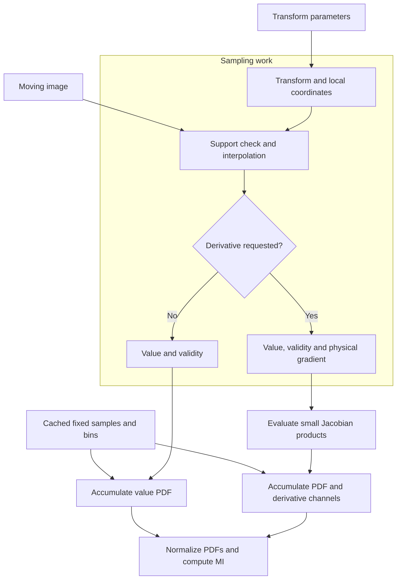
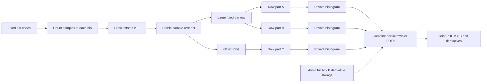
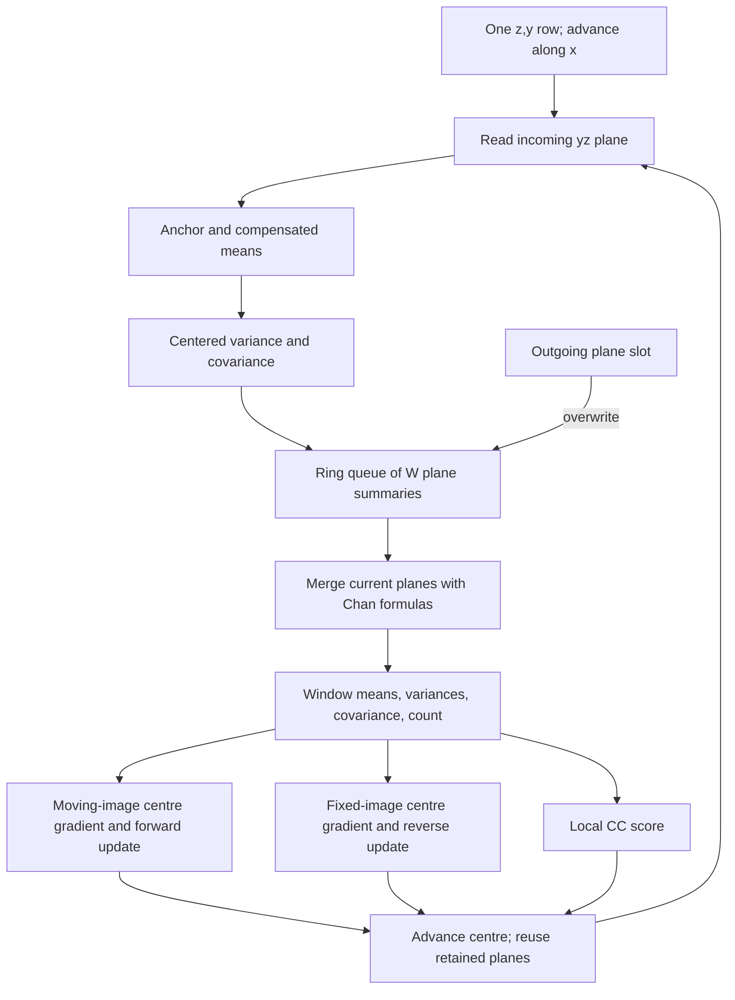
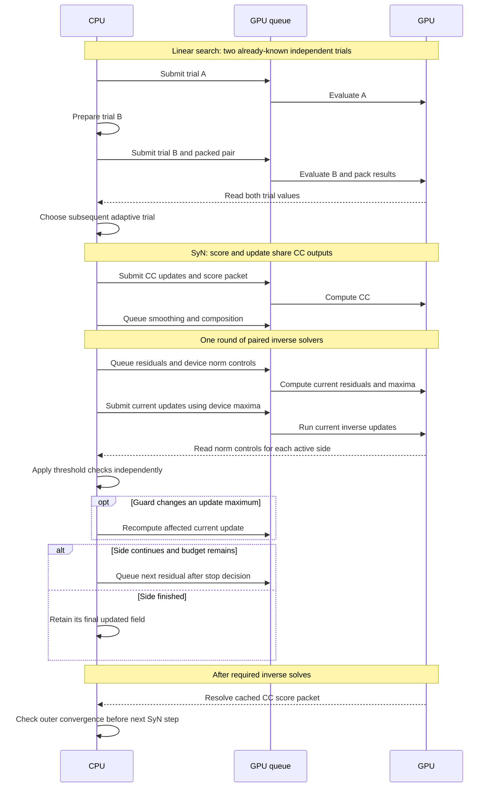

# Implementation optimizations

[English](optimizations.md) · [简体中文](../zh-CN/optimizations.md) · [Documentation](index.md)

Registration repeatedly samples images, accumulates histograms, computes neighbourhood statistics, and updates displacement fields. Most optimizations target memory traffic and repeated work in those operations. Others reduce kernel launches or CPU/GPU synchronization. The update equations are described in [registration algorithms](algorithms.md).

## Array sizes used below

| Symbol | Meaning |
| --- | --- |
| $N$ | Number of samples used by a metric |
| $V=n_xn_yn_z$ | Number of voxels in an image or field grid |
| $P$ | Number of linear transform parameters |
| $B$ | Number of histogram bins per intensity axis |
| $C$ | Number of allocated partial-histogram blocks |
| $K$ | Number of CPU workers executing blocks |
| $W$ | Number of plane summaries retained by a CC row queue |

The diagrams show data flow and dependencies, not measured durations. Memory expressions describe the listed arrays; input images, fixed sample plans, allocator overhead, and overlapping array lifetimes contribute additional storage. $C$ is a block count, not the number of workers $K$.

## 1. CPU compilation and parallel work

Numba compiles voxel and sample loops into native code. Independent rows, slices, sample blocks, and filter lines use `prange`. Each worker writes a separate output region or private histogram, followed by a reduction. This avoids concurrent floating-point updates to a shared PDF cell.

Small arrays use serial paths to avoid thread scheduling overhead. `--threads` controls the worker budget; operators also check input size before enabling parallel work. Compiled functions are cached for later processes.

The useful parallel unit depends on the operator: image sampling splits samples, field operations split rows or slices, and recursive filtering splits lines while retaining the recurrence order within each line.

Selected CPU FP32 metric operations use four-lane LLVM vectors. On Apple Silicon, these compile to 128-bit NEON instructions such as `fmla.4s`, `fsub.4s` and `fdiv.4s`. Threads process independent blocks, while vector lanes process independent values inside each block.

| Operation | Four vector lanes |
| --- | --- |
| Dense integer sample mapping | Four adjacent samples, with separate integer cells and FP32 offsets |
| Cubic Parzen accumulation | Four adjacent moving-image bins, each with its own compensated sum |
| Derivative PDF accumulation | Four contiguous transform-parameter channels |
| Unmasked CC statistics | Four neighbouring x planes, each retaining its own yz accumulation order |

The histogram lanes do not sum across samples. Each bin or parameter channel retains its scalar accumulation order, without enabling `fastmath` reassociation. Scalar tails handle counts that are not multiples of four.

Source: [shared geometry](../../src/fast_ants/backends/cpu/common/geometry.py), [FP64 filter kernels](../../src/fast_ants/backends/cpu/fp64/filter_kernels.py), [FP32 dense kernels](../../src/fast_ants/backends/cpu/fp32/dense_kernels.py), [FP32 Parzen SIMD](../../src/fast_ants/backends/cpu/fp32/metrics/parzen.py), [four-sample mapping](../../src/fast_ants/backends/cpu/fp32/metrics/coordinates.py).

## 2. Mattes MI: separate value and derivative work

A metric evaluation transforms points, interpolates the moving image, checks valid samples, and accumulates Parzen weights. Derivative evaluation also needs image gradients and transform Jacobians. Golden-section line search evaluates several trial positions using only values, so those trials skip gradient and Jacobian work.

`_sample_one` in [FP64 linear_fused.py](../../src/fast_ants/backends/cpu/fp64/metrics/linear_fused.py) combines centred transform evaluation, physical-to-index mapping, support checks, interpolation, and optional finite differences. Coordinates and gradient components are scalar local variables rather than small arrays allocated for each sample.

This is the mathematical data flow; loop and kernel boundaries differ by backend:

| Path | Data retained between sampling and histogram work |
| --- | --- |
| CPU FP64 value | `values[N]` and `states[N]` |
| CPU FP64 derivative | The above plus `gradients[N,3]`; parameter products are formed during histogram accumulation |
| CPU FP32 streaming derivative | Sampling, gradient, Jacobian products, and PDF updates run inside each block; no sample-sized gradient or `[N,P]` derivative array |
| Metal streaming derivative | Values, states, `[N,3]` gradients, moving-bin indices, and fractions; parameter products are formed by histogram kernels |

CPU FP64 therefore retains $O(N)$ sample scratch; it does not fuse the entire calculation into one pass. Metal's derivative sampling also retains $O(N)$ data. The avoided parameter-dependent allocation is the full $N\times P$ intensity-derivative array.

The fused CPU FP64 metric is selected for supported built-in linear models and compatible metric inputs. Moving-image masks, custom models, or replaced cache inputs use the general evaluation path. Fixed-image arrays are treated as read-only during a metric's lifetime.

## 3. Fixed-bin indexing and private histograms

The fixed-image bin does not change when a moving transform changes. Recomputing it for every trial wastes work. The metric prepares fixed values, bin assignments, and stable membership ordering once. Moving-image support, intensity range checks, and valid counts are still evaluated at each trial.

A CSR-style plan stores `indices[N]` and `offsets[B+1]`. The samples belonging to bin $b$ occupy `indices[offsets[b]:offsets[b+1]]`. GPU preparation uses integer counts, prefix sums, and stable scattering without downloading sample data.

### CPU FP64: split heavily populated rows

Background intensities can place many samples in one fixed bin. Assigning one worker to each bin then leaves most workers idle. The block path divides long rows into tasks of at most 32768 samples. A task owns one fixed-bin row, so its private value histogram needs `[1,B]` rather than a full `[B,B]` PDF.

Derivative tasks retain `[1,B,P]` partials. Each sample's Jacobian products are calculated once in that task. Partial rows are merged using Neumaier compensated sums; worker scheduling does not choose the merge order.

The dispatcher enables parallel sampling from 16384 samples when multiple workers are available. Histogram selection also depends on the largest bin population: small rows use row-parallel or serial evaluation; other concentrated workloads can split derivative channels.

### CPU FP32: reusable streaming workspace

`ValueWorkspace32` and `DerivativeWorkspace32` use block length `max(4096, ceil(N/128))`, giving at most 128 blocks. Their main partial arrays are `[C,B,B]` for the joint PDF and, for derivative evaluations, `[C,B,B,P]` for derivatives, each with a compensation array. Counts, validity flags, and final PDFs are reused on later evaluations. Public metric results copy the finalized PDFs so that later workspace reuse does not overwrite earlier results.

Within a block, the kernel maps a sample, interpolates it, computes its gradient and parameter contributions, and immediately adds those contributions to its private PDF. The workspace size depends on $C$, $B$, and $P$, rather than allocating $N\times P$ derivatives.

Dense integer plans map four samples at a time. Support checks and trilinear interpolation share the same axis indices, avoiding repeated floor and clipping operations. Cubic Parzen weights and contiguous derivative channels use four-lane updates; histogram block boundaries and merge order remain fixed.

For large dense metrics with gradient shifts bounded by one voxel per axis, a cached Boolean image identifies cells whose complete gradient interpolation support is zero. Three separable passes check the clipped `[i-1,i+2]` range on each axis. A marked cell can skip six shifted image interpolations and use a zero gradient. The support is prepared once per unchanged moving image, costs one retained byte per voxel, and uses no intensity threshold. Nonzero regions and unsupported shift geometry use the usual interpolation; unsafe Jacobian arithmetic retains its finite-value checks.

### Metal: share samples across parameter channels

The derivative sampling kernel returns 5 arrays: value, state, gradient, bin index, and fraction. Together these contain $7N$ 32-bit words. The histogram stage reuses that gradient for each parameter channel instead of materializing every sample/parameter product.

With a fixed-bin plan, derivative rows are divided into 128 parts. Value-only evaluation can use up to 512 parts to distribute a large background row despite having only one histogram channel. SIMD groups accumulate moving-bin weights for one row/part/channel.

| Main temporary storage | Leading array sizes |
| --- | --- |
| Materialized intensity derivatives | $NP$ scalars |
| CPU FP64 row-block derivatives | $CBP+B^2P$, plus $O(N)$ sampled values/gradients |
| CPU FP32 streaming workspace | $CB^2(P+1)$, with separate compensation arrays |
| Metal streaming derivative | $O(N)+CB^2(P+1)$ |

These expressions are array-size estimates, not total process or GPU peak memory. All methods retain some input or fixed-plan data proportional to $N$.

Source: [FP64 block accumulation](../../src/fast_ants/backends/cpu/fp64/metrics/linear_fused.py), [FP32 value workspace](../../src/fast_ants/backends/cpu/fp32/metrics/value.py), [FP32 derivative workspace](../../src/fast_ants/backends/cpu/fp32/metrics/derivative.py), [zero-gradient support](../../src/fast_ants/backends/cpu/fp32/metrics/background.py), [Metal fixed-bin plan](../../src/fast_ants/backends/metal/metrics/mattes/histogram.py), [Metal derivatives](../../src/fast_ants/backends/metal/metrics/mattes/derivative.py), [Metal value path](../../src/fast_ants/backends/metal/metrics/mattes/sampling.py).

## 4. Jacobian specialization and GPU finalization

Translation parameters select gradient components; sparse affine columns need only their active coordinate terms. The derivative code recognizes these forms and retains a general expression for composed or unrecognized models. Exact-zero gradient shortcuts are used only when geometry and coefficients satisfy the finite-value checks.

On the supported Metal control path, PDF normalization, marginals, logarithms, metric value, and descent are finalized on the GPU. A fused kernel shares joint/marginal/logarithm preparation across parameter channels. It handles 5–32 bins and up to 12 parameters with bounded shared storage.

The registration path selects these controls for compatible metrics without moving-image masks and with at least 16384 samples. Unsupported combinations retain general PDF evaluation. Public evaluations requesting PDF details continue to return those arrays.

Values, descent components, counts, and status are packed into a `uint32` result buffer. Floating-point values use their original bit patterns. The packet contains $P+3$ words, or $4(P+3)$ bytes: one metric value, $P$ descent components, a valid count, and status. It replaces a transfer of the full PDF and derivative arrays.

Source: [Jacobian plans](../../src/fast_ants/backends/metal/metrics/mattes/derivative.py), [GPU finalization](../../src/fast_ants/backends/metal/metrics/mattes/finalize_fused.py), [dispatch and result decoding](../../src/fast_ants/backends/metal/metrics/mattes/metric.py).

## 5. Local CC: reuse neighbourhood statistics

Adjacent CC windows share most of their voxels. Re-reading the entire three-dimensional window for every centre repeats both image loads and statistics.

CPU FP32 computes yz-plane summaries in two passes relative to a local intensity anchor, storing means, centred squared sums, covariance, and count. For masked or strided inputs, each `(z,y)` row uses the queue below: moving the centre along x adds one incoming plane and overwrites the outgoing queue slot.

The queue retains at most $W=\min(n_x,2r_x+1)$ summaries per active row. A summary has 7 FP32 statistics and an integer count. Current planes are merged in order with Chan formulas; the implementation does not subtract an outgoing raw variance from a running squared-sum expression.

Contiguous inputs without masks use a separate SIMD path. It computes four neighbouring x planes together and stores seven statistics per plane in `[7,n_x]` row scratch. All planes in that row have the same valid count, so Chan merge fractions and cross weights are calculated once for each window length. The centre traversal then merges planes in the same order as the queue path. This uses $O(Kn_x)$ row scratch rather than full-volume statistic arrays. The SyN driver passes the absence of masks directly, avoiding per-iteration validity-volume initialization. Dispatch does not need to scan a Boolean array to identify unmasked inputs.

Both update directions share the same statistics. The ordinary CPU FP32 path evaluates the required centre gradients directly, avoiding two full `[3,z,y,x]` gradient arrays. CPU FP64 also reuses queued plane statistics and shares unmasked paired traversal.

### Metal windows and tiles

The short-window path uses 3 passes: x computes centred statistics; y merges groups; z merges the remaining groups and writes both updates. Each intermediate contains 5 FP32 channels and one `uint32` count, or $24V$ bytes. Array release follows its last dependent kernel; actual peak memory also includes gradients, updates, and overlapping intermediates.

This path handles radii 0–4. A separate tiled path loads fixed/moving intensities and validity into threadgroup memory, including the halo around a `16x4x4` output tile; it handles radii up to 2. Both use the general neighbourhood implementation outside their supported radius. Masks and clipped edge windows are included in the statistics.

Source: [CPU FP32 queue](../../src/fast_ants/backends/cpu/fp32/metrics/cc_queue.py), [CPU FP32 unmasked SIMD](../../src/fast_ants/backends/cpu/fp32/metrics/cc_simd.py), [FP64 paired CC](../../src/fast_ants/backends/cpu/fp64/metrics/cc_pair.py), [Metal window passes](../../src/fast_ants/backends/metal/metrics/cc/window.py), [Metal shared-memory tiles](../../src/fast_ants/backends/metal/metrics/cc/tiled.py).

## 6. Field filtering, composition, and inversion

Field convolution streams the native `[3,z,y,x]` layout. Axis selection changes source strides instead of rearranging all components into temporary line arrays. The final Metal pass also performs boundary zeroing and small-variance blending.

Metal SyN combines update scaling with composition. Once the global norm provides a scale, interpolation reads scaled update values while writing the composed field; a separate scaled-update volume is unnecessary. Diagnostic capture retains separate intermediates when requested.

Same-grid inverse residuals use local indices and physical displacement components. Algebraically cancelling the common grid mapping avoids repeated world-coordinate round trips and preserves small offsets near large origins. Residual interpolation, error norms, finite checks, and block summaries share the same traversal.

Each inverse solver evaluates residuals, updates the field and checks convergence. Internal registration computes the additional post-update residual scan only when diagnostics require it. Final outputs receive the full quality checks.

Source: [FP64 local residuals](../../src/fast_ants/backends/cpu/fp64/local_fields.py), [FP32 inverse workspace](../../src/fast_ants/backends/cpu/fp32/inverse.py), [Metal field filtering](../../src/fast_ants/backends/metal/filtering.py), [scaled composition](../../src/fast_ants/backends/metal/fields/composition.py).

## 7. Workspaces and image preparation

Allocating fresh vector fields in every iteration creates repeated allocation and copy traffic. Each sequential CPU SyN level owns reusable smoothing buffers, a validity mask, and inverse residual/norm scratch. Two batches of 4 state fields alternate between readable current state and writable output.

Each state field has shape `[3,z,y,x]`. Buffer reuse is private to the sequential driver: callbacks, diagnostic capture, and public operator results keep independent storage as needed. Reusing a buffer waits until its prior contents are no longer read.

The Metal preparation cache reuses positive-sigma smoothed images across stages. Its key contains source-array identity, grid identity, sigma, and units; its lifetime is one registration and its capacity is bounded. Zero-sigma results are not retained in this cache.

Source: [FP64 SyN workspace](../../src/fast_ants/backends/cpu/fp64/syn.py), [FP32 SyN workspace](../../src/fast_ants/backends/cpu/fp32/syn.py), [Metal preparation cache](../../src/fast_ants/backends/metal/preparation.py).

## 8. CPU/GPU asynchronous scheduling

A host read can force evaluation of a lazy GPU graph. Submitting independent work first allows the CPU to prepare another operation while the GPU executes its queued work. The scheduling below shows dependencies; it does not imply simultaneous execution of kernels on one queue.

The value-trial path batches only independent points already required by line search. Trials chosen from those values are prepared afterward. The CC packet is resolved once and shared by both direction results.

Paired inversions combine control transfers while keeping each side's iteration count and stopping decision. The current update is submitted before reading the stop values because the solver updates before checking those values. No dependent next iteration is submitted before its decision. A numerical threshold guard may replace one prequeued update without changing caller-owned arrays.

`MetalContext.submit` calls `mx.async_eval`. Configurations without asynchronous support retain paired synchronous scheduling. Full image/field downloads are reserved for final products or requested diagnostics.

Source: [Metal runtime](../../src/fast_ants/backends/metal/runtime.py), [inverse scheduling](../../src/fast_ants/backends/metal/fields/overlap.py), [deferred CC packet](../../src/fast_ants/backends/metal/metrics/cc/control.py), [trial batching](../../src/fast_ants/backends/metal/metrics/mattes/metric.py).

## 9. Final quality checks and I/O

The Metal output path uses CPU blocks for inverse-consistency and Jacobian summaries. It reads FP32 fields directly and promotes samples before arithmetic, avoiding full FP64 field copies, residual-vector fields, and a Jacobian output volume. Exact percentile calculation still retains a scalar norm buffer of length up to $V$.

The input pair is read with at most 2 threads. For compatible contiguous NIfTI payloads, a `memoryview` is written in 1 MiB chunks instead of constructing another image-sized byte string; required dtype or layout conversions may still allocate. Independent image and field outputs use up to 3 writer threads, and all writers are joined before registration returns.

Source: [output quality kernels](../../src/fast_ants/quality/output_kernels.py), [image I/O](../../src/fast_ants/io/images.py), [NIfTI writer](../../src/fast_ants/io/nifti.py), [Metal output orchestration](../../src/fast_ants/backends/metal/registration.py).

## Numerical stability and profiling

Centred statistics, compensated sums, pairwise reductions, local coordinates, and difference-driven Gaussian sections reduce cancellation and accumulation error. They use ordinary FP32 or FP64 arithmetic. Fusion retains sample validity, field units, composition order, and stopping conditions.

Execution time depends on image size, iteration count, sampling density, allocation, memory bandwidth, compilation, and synchronization. Use the [measurement tools](../../validation/README.md) to profile the relevant workload.
