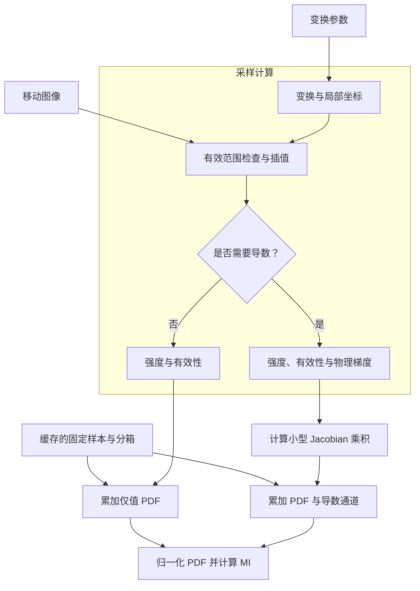
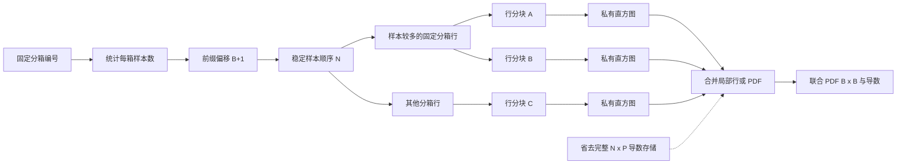
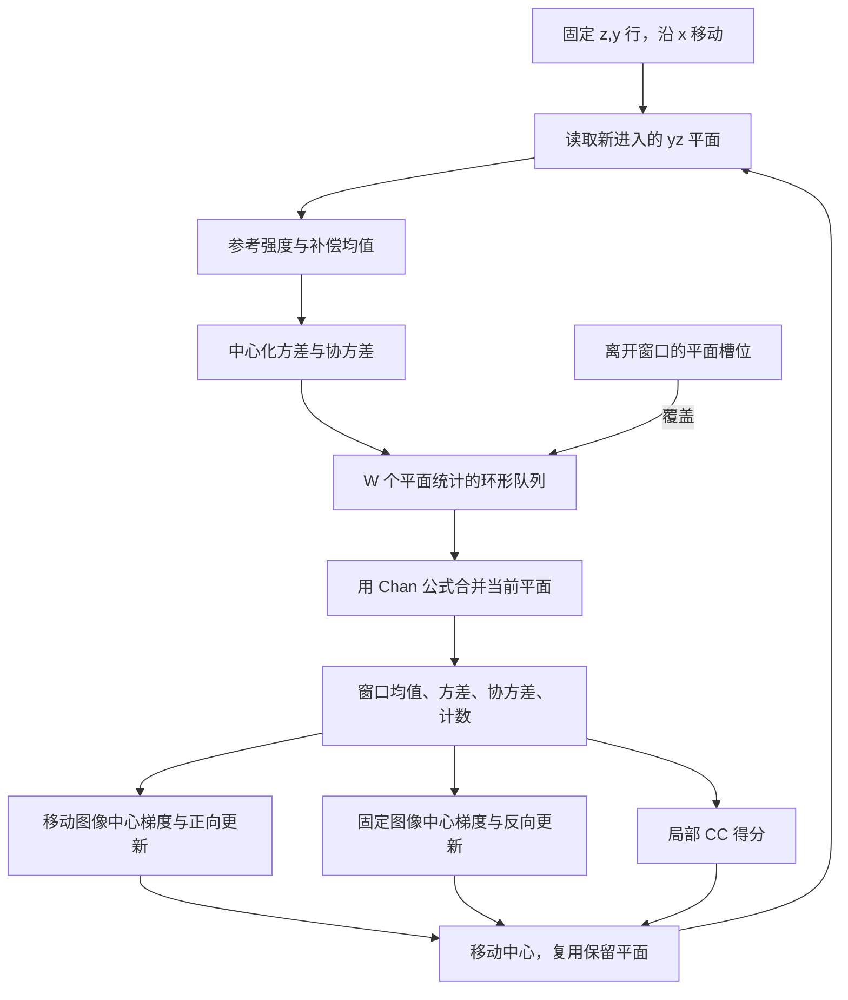
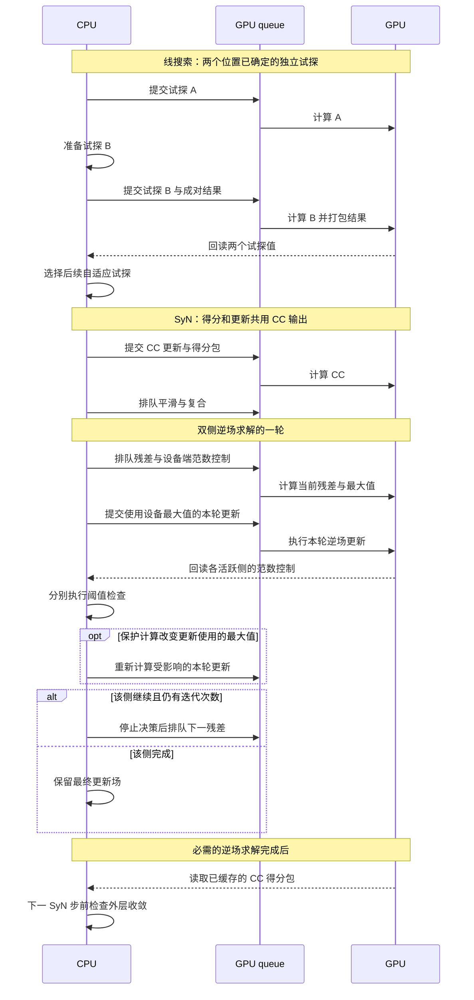

# 实现优化

[English](../en/optimizations.md) · [简体中文](optimizations.md) · [文档](index.md)

配准会反复执行图像采样、直方图累加、邻域统计和位移场更新。多数优化针对这些运算的内存访问和重复计算，另一些用于减少 kernel 启动或 CPU／GPU 同步。更新公式见[配准算法](algorithms.md)。

## 下文使用的数组规模

| 符号 | 含义 |
| --- | --- |
| $N$ | 度量使用的样本数 |
| $V=n_xn_yn_z$ | 图像或场网格的体素数 |
| $P$ | 线性变换参数数 |
| $B$ | 每个强度轴的直方图分箱数 |
| $C$ | 已分配的局部直方图块数 |
| $K$ | 执行分块的 CPU 工作线程数 |
| $W$ | CC 行队列保留的平面统计数 |

示意图展示数据流和依赖关系，不表示实测耗时。内存表达式描述所列数组，输入图像、固定采样计划、分配器开销及数组生命周期重叠还会占用其他空间。$C$ 是块数，不是工作线程数 $K$。

## 1. CPU 编译与并行任务

Numba 将体素和样本循环编译为本地代码，独立行、切片、样本块和滤波线使用 `prange`。各线程写入不同输出区域或私有直方图，再合并结果，避免对共享 PDF 单元进行并发浮点更新。

小数组使用串行路径以减少线程调度开销。`--threads` 设置线程数，算子还会根据输入规模决定是否并行，编译后的函数供后续进程缓存复用。

不同算子的并行单位不同：图像采样按样本划分，场运算按行或切片划分，递归滤波按线划分，同时保持每条线内部的递推顺序。

CPU FP32 的部分度量计算还使用显式四路 LLVM 向量。在 Apple Silicon 上，生成的汇编包含 `fmla.4s`、`fsub.4s`、`fdiv.4s` 等 NEON 指令。向量代码使用宿主 CPU 的指令集；AVX2 属于 x86，Apple Silicon 不使用它。多线程与 SIMD 分别处理不同层次的并行：线程负责独立分块，向量通道处理块内相互独立的数据。

| 运算 | 四个向量通道 |
| --- | --- |
| 稠密整数采样映射 | 四个相邻样本，各自保留整数单元与 FP32 偏移 |
| 三次 Parzen 累加 | 四个相邻移动图像分箱，各自维护补偿求和 |
| 导数 PDF 累加 | 四个连续的变换参数通道 |
| 无掩膜 CC 统计 | 四个相邻 x 平面，各自保留原有 yz 累加顺序 |

直方图向量通道不跨样本求和。各分箱和参数通道保留标量累加顺序，不启用 `fastmath` 重排；不足四个元素的尾部使用标量处理。

源码：[共享几何](../../src/fast_ants/backends/cpu/common/geometry.py)、[FP64 滤波 kernel](../../src/fast_ants/backends/cpu/fp64/filter_kernels.py)、[FP32 稠密 kernel](../../src/fast_ants/backends/cpu/fp32/dense_kernels.py)、[FP32 Parzen SIMD](../../src/fast_ants/backends/cpu/fp32/metrics/parzen.py)、[四样本映射](../../src/fast_ants/backends/cpu/fp32/metrics/coordinates.py)。

## 2. Mattes MI：区分仅值计算与导数计算

一次度量求值需要变换采样点、插值移动图像、判断有效样本并累加 Parzen 权重，导数求值还需要图像梯度和变换 Jacobian。黄金分割线搜索对多个试探位置只计算度量值，因此这些试探会跳过梯度和 Jacobian。

[FP64 linear_fused.py](../../src/fast_ants/backends/cpu/fp64/metrics/linear_fused.py) 中的 `_sample_one` 组合了带中心的变换计算、物理坐标到索引的映射、有效范围检查、插值及可选有限差分。坐标和梯度分量使用局部标量，不为每个样本单独分配小数组。

图中是数学数据流，各后端的循环和 kernel 划分不同：

| 路径 | 采样和直方图之间保留的数据 |
| --- | --- |
| CPU FP64 仅值 | `values[N]` 和 `states[N]` |
| CPU FP64 导数 | 上述数组及 `gradients[N,3]`，参数乘积在直方图累加时计算 |
| CPU FP32 流式导数 | 每块内部完成采样、梯度、Jacobian 乘积和 PDF 更新，不保留样本规模的梯度或 `[N,P]` 导数数组 |
| Metal 流式导数 | 强度、状态、`[N,3]` 梯度、移动分箱及小数部分，参数乘积在直方图 kernel 中计算 |

因此 CPU FP64 仍保留 $O(N)$ 的采样临时数组，并非将全部计算融合为一次遍历。Metal 导数采样也保留 $O(N)$ 数据，省去的是随参数数增长的完整 $N\times P$ 强度导数数组。

CPU FP64 融合路径用于支持的内置线性模型和兼容的度量输入；移动图像掩膜、自定义模型或不再匹配缓存的输入走通用求值路径。固定图像数组在一次度量的使用期间按只读处理。

## 3. 固定分箱索引与私有直方图

移动变换改变时，固定图像的分箱不会改变，每次试探都重新分箱会重复计算。度量初始化时准备固定强度、分箱和稳定分组顺序；移动图像的有效范围、强度检查和有效计数仍对每个试探位置重新计算。

CSR 形式的计划保存 `indices[N]` 和 `offsets[B+1]`，分箱 $b$ 的样本位于 `indices[offsets[b]:offsets[b+1]]`。GPU 通过整数计数、前缀和及稳定分散写入建立计划，无须下载样本数据。

### CPU FP64：拆分样本集中的分箱行

背景强度可能将大量样本集中到一个固定分箱。如果每个分箱只分配一个线程，多数线程就会空闲。分块路径将长行拆为每块最多 32768 个样本的任务；每个任务只负责一个固定分箱行，因此私有仅值直方图使用 `[1,B]`，无需完整 `[B,B]` PDF。

导数任务保存 `[1,B,P]` 局部结果，每个样本的 Jacobian 乘积在任务中只计算一次。合并局部行时使用 Neumaier 补偿求和，合并顺序不由线程完成顺序决定。

多线程可用时，调度器从 16384 个样本开始启用并行采样。直方图路径还取决于最大分箱行的样本数：较小行使用按行并行或串行求值，其他集中分布也可按导数通道拆分。

### CPU FP32：可复用流式工作区

`ValueWorkspace32` 和 `DerivativeWorkspace32` 的块长为 `max(4096, ceil(N/128))`，因此最多有 128 个块。主要局部数组为联合 PDF 的 `[C,B,B]`，导数求值还使用 `[C,B,B,P]`，两者均有补偿数组；计数、有效标志和最终 PDF 在后续求值时复用。公共度量结果会复制最终 PDF，后续工作区复用不会覆盖已返回的结果。

块内每处理一个样本，就完成映射、插值、梯度和参数贡献计算，并立即累加到私有 PDF。工作区大小由 $C$、$B$ 和 $P$ 决定，无须分配 $N\times P$ 导数。

稠密整数采样计划每次映射四个样本。有效性检查与三线性插值共享各轴的索引，省去重复的取整和边界截断。三次 Parzen 权重与连续导数通道使用四路更新，直方图分块边界和合并顺序保持固定。

对于梯度位移各轴不超过一个体素的大型度量，缓存一个布尔图像，标记梯度插值支持域完全为零的单元。预处理通过三次可分离遍历，检查各轴截断后的 `[i-1,i+2]` 范围；命中后直接使用零梯度，省去六次偏移插值。支持域只针对每幅不变的移动图像准备一次，保留空间为每体素一个字节，不使用强度阈值。非零区域和不支持的位移几何继续执行常规插值，不安全的 Jacobian 运算仍保留有限值检查。

### Metal：参数通道共享采样结果

导数采样 kernel 返回 5 个数组：强度、状态、梯度、分箱编号和小数部分，总共包含 $7N$ 个 32 位元素。直方图阶段为各参数通道复用梯度，不保存所有样本／参数乘积。

使用固定分箱计划时，导数行划分为 128 份。仅值路径只有一个直方图通道，因此可使用最多 512 份分块来分散大型背景行。SIMD 组累加一个行／块／通道对应的移动端分箱权重。

| 主要临时存储 | 主要数组规模 |
| --- | --- |
| 完整强度导数 | $NP$ 个标量 |
| CPU FP64 行分块导数 | $CBP+B^2P$，另有 $O(N)$ 采样强度／梯度 |
| CPU FP32 流式工作区 | $CB^2(P+1)$，另有独立补偿数组 |
| Metal 流式导数 | $O(N)+CB^2(P+1)$ |

这些是数组规模估算，不是进程或 GPU 峰值内存。各方法仍会保留一部分随 $N$ 增长的输入或固定计划数据。

源码：[FP64 分块累加](../../src/fast_ants/backends/cpu/fp64/metrics/linear_fused.py)、[FP32 仅值工作区](../../src/fast_ants/backends/cpu/fp32/metrics/value.py)、[FP32 导数工作区](../../src/fast_ants/backends/cpu/fp32/metrics/derivative.py)、[零梯度支持域](../../src/fast_ants/backends/cpu/fp32/metrics/background.py)、[Metal 固定分箱计划](../../src/fast_ants/backends/metal/metrics/mattes/histogram.py)、[Metal 导数](../../src/fast_ants/backends/metal/metrics/mattes/derivative.py)、[Metal 仅值路径](../../src/fast_ants/backends/metal/metrics/mattes/sampling.py)。

## 4. Jacobian 专用计算与 GPU 终结处理

平移参数只需选择梯度分量，稀疏仿射列只需计算对应坐标项。导数代码识别这些形式；复合或未识别模型保留通用表达式。仅在几何和系数通过有限值检查时使用精确零梯度省算。

支持的 Metal 控制路径在 GPU 上完成 PDF 归一化、边缘分布、对数、度量值和下降方向。融合 kernel 在参数通道间共享联合／边缘分布及对数准备，使用有限共享存储支持 5–32 个分箱和最多 12 个参数。

配准流程仅对兼容、无移动图像掩膜且至少有 16384 个样本的度量使用这些控制，不支持的组合保留通用 PDF 求值。请求 PDF 细节的公共求值仍返回这些数组。

度量值、下降分量、计数和状态打包到 `uint32` 结果缓冲区，浮点值保持原始位模式。结果包包含 $P+3$ 个元素，即 $4(P+3)$ 字节：一个度量值、$P$ 个下降分量、有效计数和状态，无须回读完整 PDF 和导数数组。

源码：[Jacobian 计划](../../src/fast_ants/backends/metal/metrics/mattes/derivative.py)、[GPU 终结处理](../../src/fast_ants/backends/metal/metrics/mattes/finalize_fused.py)、[调度与结果解码](../../src/fast_ants/backends/metal/metrics/mattes/metric.py)。

## 5. 局部 CC：复用邻域统计

相邻 CC 窗口共享大部分体素。如果每个中心都重新读取整个三维窗口，会重复访问图像并计算统计量。

CPU FP32 对 yz 平面以局部强度为参考，用两遍计算保存均值、离均差平方和、协方差和计数。带掩膜或非连续输入按 `(z,y)` 行使用下图的统计队列：中心沿 x 移动时加入一个新平面，覆盖离开窗口的队列槽位。

每个活跃行保留最多 $W=\min(n_x,2r_x+1)$ 个统计，每个统计包含 7 个 FP32 数值和一个整数计数。当前平面按顺序用 Chan 公式合并，并不通过从平方和中直接减去移出平面的原始方差来更新。

连续且无掩膜的输入使用独立 SIMD 路径，一次计算四个相邻 x 平面，在 `[7,n_x]` 行缓冲区保存各平面的七个统计量。同一行各平面的有效计数相同，因此每种窗口长度的 Chan 合并比例和交叉权重只计算一次；中心遍历仍按队列路径的顺序合并平面。行缓冲区规模为 $O(Kn_x)$，无须保存全图统计数组。SyN 直接传递无掩膜状态，省去每轮有效性图初始化；调度时无须扫描布尔数组判断是否有掩膜。

两侧更新共用统计量。普通 CPU FP32 路径直接计算所需中心梯度，省去两份完整 `[3,z,y,x]` 梯度数组。CPU FP64 也复用平面队列，并在无掩膜双向计算中共享遍历。

### Metal 窗口与分块

短窗口路径有 3 次遍历：x 方向计算中心化统计，y 方向合并分组，z 方向合并剩余分组并写出双向更新。每份中间结果包含 5 个 FP32 通道和一个 `uint32` 计数，即 $24V$ 字节。数组在最后一个依赖 kernel 使用后释放，实际峰值还包含梯度、更新和生命周期重叠的中间结果。

该路径支持半径 0–4。独立的分块路径将固定／移动强度及有效性加载到 threadgroup 共享内存，包括 `16x4x4` 输出块周围的 halo，支持半径不超过 2。两者在半径超出支持范围时使用通用邻域实现，掩膜和边缘截断窗口都计入统计。

源码：[CPU FP32 队列](../../src/fast_ants/backends/cpu/fp32/metrics/cc_queue.py)、[CPU FP32 无掩膜 SIMD](../../src/fast_ants/backends/cpu/fp32/metrics/cc_simd.py)、[FP64 双向 CC](../../src/fast_ants/backends/cpu/fp64/metrics/cc_pair.py)、[Metal 窗口遍历](../../src/fast_ants/backends/metal/metrics/cc/window.py)、[Metal 共享内存分块](../../src/fast_ants/backends/metal/metrics/cc/tiled.py)。

## 6. 场滤波、复合与求逆

场卷积直接顺序访问原有 `[3,z,y,x]` 布局，用源数据步长选择轴，无须把全部分量重排成临时线数组。Metal 最后一遍还完成边界清零和小方差混合。

Metal SyN 融合更新缩放与复合。全场范数提供缩放系数后，插值在写入复合场时读取缩放后的更新值，无须单独存储缩放更新场。请求诊断捕获时仍保留各中间结果。

同网格逆残差使用局部索引和物理位移分量，通过代数消去共同的网格映射，避免反复转换到世界坐标，也保留大原点附近的小偏移。残差插值、误差范数、有限值检查和分块摘要共享同一次遍历。

每个求逆器仍执行残差更新和原有停止检查。内部配准在额外更新后残差只供诊断时跳过这次扫描，最终输出质量检查仍保留。

源码：[FP64 局部残差](../../src/fast_ants/backends/cpu/fp64/local_fields.py)、[FP32 逆场工作区](../../src/fast_ants/backends/cpu/fp32/inverse.py)、[Metal 场滤波](../../src/fast_ants/backends/metal/filtering.py)、[缩放与复合](../../src/fast_ants/backends/metal/fields/composition.py)。

## 7. 工作区与图像预处理

每次迭代都分配新的向量场，会反复产生内存分配和复制。每个顺序执行的 CPU SyN 层级拥有可复用的平滑缓冲、有效掩膜和逆残差／范数空间，两批各含 4 个状态场的缓冲在可读当前状态和可写输出之间交替。

每个状态场的形状为 `[3,z,y,x]`。缓冲复用仅用于顺序驱动内部，回调、诊断捕获和公共算子结果按需要使用独立存储，前一内容不再被读取后才能复用对应缓冲区。

Metal 预处理缓存跨阶段复用正 sigma 的平滑图像，键包含源数组身份、网格身份、sigma 和单位，使用范围限于一次配准且容量有上限；不在此缓存中保留零 sigma 结果。

源码：[FP64 SyN 工作区](../../src/fast_ants/backends/cpu/fp64/syn.py)、[FP32 SyN 工作区](../../src/fast_ants/backends/cpu/fp32/syn.py)、[Metal 预处理缓存](../../src/fast_ants/backends/metal/preparation.py)。

## 8. CPU／GPU 异步调度

主机回读可能迫使延迟 GPU 计算图求值。先提交独立工作，可以让 CPU 在 GPU 执行队列任务时准备另一项操作。下图展示依赖关系，不表示同一队列中的 kernel 同时执行。

仅值试探路径只批处理线搜索中已经需要且相互独立的位置，根据试探值决定的下一位置在之后准备。CC 得分包只解析一次，供两个方向结果共享。

双侧求逆在合并控制量传输的同时，保留各自的迭代次数和停止决策。因为求逆器先更新再检查这些数值，本轮更新可以在回读停止值之前提交；依赖下一轮的工作不会早于决策提交。数值阈值保护可能替换一个预先排队的更新，但不改写调用者数组。

`MetalContext.submit` 调用 `mx.async_eval`；不具备异步支持的配置保留双侧同步调度。完整图像／场只在最终输出或用户请求诊断时下载。

源码：[Metal 运行时](../../src/fast_ants/backends/metal/runtime.py)、[逆场调度](../../src/fast_ants/backends/metal/fields/overlap.py)、[延后读取 CC 包](../../src/fast_ants/backends/metal/metrics/cc/control.py)、[试探批处理](../../src/fast_ants/backends/metal/metrics/mattes/metric.py)。

## 9. 最终质量检查与 I/O

Metal 输出路径按 CPU 分块计算逆一致性和 Jacobian 摘要，直接读取 FP32 场并在计算前提升采样值精度，避免完整 FP64 场副本、残差向量场和 Jacobian 输出体积。精确分位数仍保留长度最多为 $V$ 的标量范数缓冲。

输入图像对使用最多 2 个线程读取。对布局兼容的连续 NIfTI 数据，`memoryview` 按 1 MiB 分块写入，避免再构造完整图像大小的字节串；需要转换 dtype 或存储布局时仍可能分配。独立图像和场使用最多 3 个写出线程，配准返回前等待全部线程完成。

这些优化分别减少不同开销：流式质量检查减少临时数组，分块写出省去字节复制，并行压缩输出重叠独立工作。

源码：[输出质量 kernel](../../src/fast_ants/quality/output_kernels.py)、[图像 I/O](../../src/fast_ants/io/images.py)、[NIfTI 写出](../../src/fast_ants/io/nifti.py)、[Metal 输出流程](../../src/fast_ants/backends/metal/registration.py)。

## 数值稳定性与性能分析

中心化统计、补偿求和、成对归约、局部坐标和差分驱动的高斯二阶节用于减少相消与累积误差。这些方法使用普通 FP32 或 FP64 算术；融合仍保留样本有效性、场单位、复合顺序和停止条件。

实际耗时取决于图像尺寸、迭代次数、采样密度、内存分配、带宽、编译与同步，可使用[计时工具](../../validation/README.zh-CN.md)分析对应任务。
